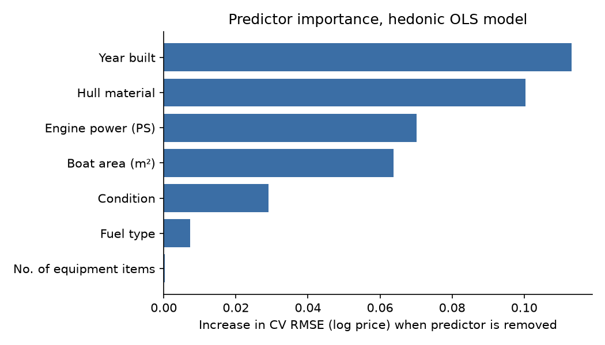

# Swiss Boat Valuation

A hedonic pricing model that estimates the asking price of used motorboats in Switzerland from their specifications, built on listings scraped from boot24.ch.



## Problem
Used boat prices in Switzerland vary widely, and buyers and sellers have little to go on beyond comparing individual listings. We wanted to know which characteristics drive the price of a motorboat and how well a simple, interpretable model can predict it from the specifications in a listing.

## Data
- **Source:** used motorboat listings on [boot24.ch](https://www.boot24.ch/chde/occasionsboote/?cat=2), collected with `requests` and BeautifulSoup.
- **Collection:** scraped between March and April 2025; the dataset used for modelling is the scrape from 4 April 2025.
- **Size:** 3,167 listings scraped; 2,346 after cleaning; 909 listings with complete specifications used for modelling.
- **Features:** price (CHF), year built, engine power, length/width/area, hull material, fuel type, condition, engine make, drive type, lake/location and equipment flags.
- Only the cleaned dataset (`outputs/2025-04-07_cleaned_data.csv`) is versioned. Raw scrapes can be re-created with the pipeline below.

## Approach
- **Pipeline:** modular scraper (`pipeline/stages/data_acquisition.py`) collects listing URLs and detail pages; `DataCleaner` renames, type-converts and standardizes columns (units, lakes, materials, engine makes).
- **Feature selection:** dropped variables with more than 40% missing values, then removed listings with missing values in the remaining columns.
- **Target:** log-transformed price, since prices are strongly right-skewed.
- **Model:** OLS regression (statsmodels) with categorical dummies; tested an interaction between engine make and engine power and dropped it because no interaction term was significant.
- **Validation:** 20-fold cross-validation stratified on price deciles (scikit-learn), adding each candidate predictor to a 7-variable core model and comparing out-of-fold RMSE.

## Results
Final model: OLS on log price with 7 predictors (year built, hull material, engine power, boat area, condition, fuel type, number of equipment items).

| Metric (20-fold CV, out-of-fold) | Baseline: median price | Hedonic OLS |
|---|---|---|
| R² (log price) | 0.00 | **0.82** |
| Median absolute error | CHF 30,900 | **CHF 10,362** |
| Median absolute % error | 64.5% | **24.0%** |
| Predictions within ±20% of asking price | 13.3% | **43.0%** |
| Mean absolute error | CHF 58,562 | CHF 31,801 |

- In-sample fit of the full OLS model: R² 0.857 (adjusted 0.847).
- Year built and hull material carry the most predictive information; the number of equipment items is significant in the OLS fit but adds almost nothing out of sample.
- The gap between mean (CHF 31.8k) and median (CHF 10.4k) absolute error shows that large errors concentrate on a few expensive boats.

## My contribution
Team project with Marcel Amrein and Fadri Campell (HSLU, CIP module, spring 2025). Marcel and I built the data collection and processing: the web scraper, the cleaning pipeline and feature preparation. Fadri built the models and visualizations.

## How to run
Requires Python 3.11.

```bash
python -m venv .venv && source .venv/bin/activate
pip install -r requirements.txt

# Modelling on the versioned cleaned dataset
jupyter lab hedonic_model.ipynb

# Optional: re-scrape boot24.ch (takes a while, writes to outputs/)
python main.py
```

`main_acquisition.py` and `main_data_cleaning.py` run the scraping and cleaning stages separately from a saved URL or raw-data file in `outputs/`. Running the cleaning stage on the 4 April 2025 raw scrape reproduces the versioned cleaned dataset exactly.

## Repository structure
```
├── hedonic_model.ipynb      # EDA, OLS models, cross-validation, evaluation
├── main.py                  # full pipeline: scrape -> clean -> CSV
├── pipeline/stages/         # DataAcquisition (scraper) and DataCleaner
├── config/                  # column mappings
├── outputs/                 # cleaned dataset used by the notebook
├── docs/                    # figures for this README
└── archive/legacy_pipeline/ # first version of the scraper, kept for reference
```

## Limitations & next steps
- Asking prices from a single marketplace, not transaction prices; one snapshot in time.
- Removing listings with missing values cuts the data from 2,346 to 909 listings and may bias the sample towards well-documented boats. Imputation would keep more data.
- Only linear models were compared. A gradient-boosting model could capture non-linear effects (for example of engine power) and would be a useful benchmark.
- The scraper depends on the boot24.ch page structure as of April 2025 and may need updates.
